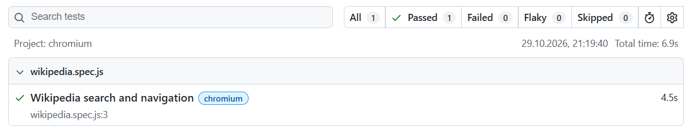

# Playwright Tests

E2E-тесты для проверки поиска и навигации на Wikipedia.

## Требования
- Node.js >= 18
- npm

## Запуск
1. `npm install`
2. `npx playwright test`
3. `npx playwright show-report`

## Скриншот прохождения тестов
